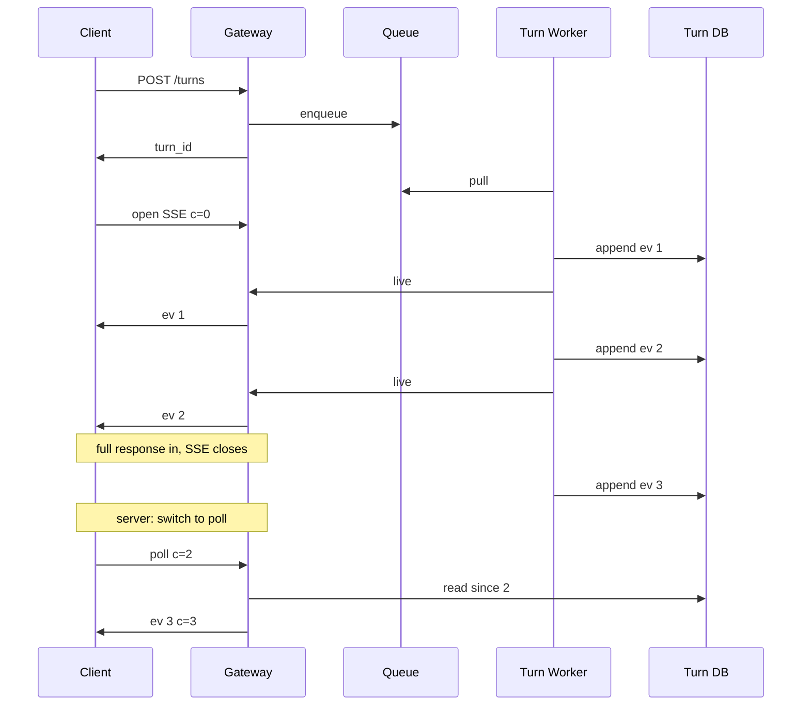

In early 2025, my team was asked to build an AI product at a consumer brokerage. The scope was clear: personalized information retrieval, then personalized actions inside the app. A question about an account, the market, a tax lot, or a comparison of a portfolio and the market should be answered with that customer's context, not a generic FAQ. If the customer asks for an action, the assistant should be able to take it.

I built most of the system, about 80% of it. One post cannot cover it, so this is a series.

This post is the map, then the transport that made the chat feel live on a phone: **turn-based SSE + short poll**.

---

Story — early 2025
------------------

I wanted the chat to feel live. Paragraphs arrive as they are ready. Tool calls arrive as they run. The user should not wait on a spinner for twenty seconds and then receive a wall of text.

From the start I wanted a native streaming design, and as few hops as possible between the client and the process that runs the turn. Mobile and web share one protocol. If a later version needs a background agent, the same path should still work.

That last requirement is the constraint. A protocol that only works while the user is on the screen cannot carry a background agent. The socket closes. The turn is still running. Unless those two lifetimes share a design, the product splits in two.

The first version is simple: the client opens a stream and the server writes the answer. It works when the turn is short and the user stays on the screen.

Then the turns got longer. Research. Multiple tools. The user switches apps. The OS closes the socket. The network drops. A held-open SSE is a radio station. If the listener leaves, the broadcast continues without them.

> A live SSE is a radio station. Whoever is connected hears the events as they are written.
>
> A persisted turn is a recording. The client can leave and resume from the last event it applied.

The question was how to let the user leave and return to the same turn without replaying the model.

I tried the usual answers:

- **Only SSE.** It works while the client stays connected. There is no resume. You either buffer in memory or you lose the events already sent.
- **Only WebSocket.** The same reconnect problem, and every proxy, load balancer, and mobile OS has its own timeout for a long-lived socket.
- **Only short poll.** Resume is straightforward. The chat does not feel live. The client pays for an "is there anything new?" request even when the answer is no.

I chose a hybrid.

**Turn-based SSE** is the live path. The socket opens when the query starts and closes when the full response is in. I stream paragraph by paragraph, not token by token — legal and compliance did not want a token firehose on the client.

When that SSE ends, the server tells the client to **short-poll**. That is how slower updates arrive after the turn: a late tool, a follow-up, anything that is not the live answer itself.

---

The Infrastructure
------------------


This is the map. The spotlight is the live path — gateway, queue, turn worker — because the other boxes have their own posts.

On the user side, Android, iOS, and web talk to a **Gateway** with turn-based SSE plus short poll. The gateway does not run the agent. It accepts a turn, drops it on a **Message Queue**, and gives the client a `turn_id`. A **Turn Worker** pulls the job, writes the conversation, and drives an **Agent Loop**. The loop uses in-code skills and sub-agents, calls tools, reads a knowledge vector store, and talks to an LLM gateway that does the model routing.

The worker is the source of truth for a turn. It reads and writes a **Turn DB** and a **Conversation DB**. Tool traffic also lands in an analytical store. Traces record what the loop did.

On the engineer side there is a second path. A daily eval job runs the case fixtures I keep in the repo. Persona fixtures and scenario fixtures feed those cases. Production sampling can propose fixture updates through a PR. Ingestion jobs fill the knowledge store from things like filings, help-center docs, and corporate actions. None of that is this post.

The point of the map is this: the client never talks to the agent loop directly. It talks to the gateway. The gateway talks to a queue. The worker owns the turn. That split is what makes streaming and leaving the screen the same design.

The platform map is the boxes. The next figure is how the service is structured.


I built the service on **dependency injection**. Endpoint, Service, and Agent Runner do not construct their own clients. The App and the clients live in DI. A store, a tool, or a model client can be replaced without the rest of the stack changing.

The **Agent Runner** is its own box on purpose. The endpoint does not run the agent. The service does not run the agent. The runner is the only thing that talks to the LLM gateway. That is how a turn stays stoppable, how the runner can be tested without a model, and how agent internals stay out of HTTP.

**Observability** is declarative, on the request path. An endpoint declares what to record — TTFT, TTFB (time to first *block*, because I stream paragraphs, not tokens), tool calls — and the instrumentation sits on the request. The runner does not call `start_timer()`.


A quiet production day is **P50 ~8s** and **P90 ~15s** to that first block. The user is already reading. The rest of the turn is still running.

The architecture is two ideas:

- **Separation of concern**, via dependency injection. HTTP, the turn, and the model call have different owners.
- **Declarative programming.** Especially observation. The metrics are a declaration.

---

Hybrid Streaming
----------------

The same split, in the protocol.

The **Turn DB** is the recording. Every paragraph, tool start, tool result, and final answer is an append-only event with a cursor. The model runs once. Reconnect reads events after `cursor=n`. The model does not run again.

**Turn-based SSE** is the live path for one turn. The client opens `GET /turns/{id}/events?cursor=n` when the query starts. Paragraphs flow until the full response is in. Then the socket closes on purpose. I do not stream token by token. Legal and compliance wanted whole paragraphs, not a drip of half-sentences.

**Short poll** starts after the live response. The server tells the client to switch. The client calls `GET /turns/{id}?cursor=12`. The gateway reads the Turn DB and returns anything slow that landed after the live answer — a late tool, a follow-up, a cancel. If the SSE closes mid-turn, the same poll is how the client catches up. The next read starts from the last cursor the client applied.

A turn the user has left can still be the wrong turn, so compute has to be **stoppable**. Cancel is another write on the same log. The worker sees it and stops.

A stop request becomes a `cancel_turn` call on the chat layer. Chat cancels the stream, the stream calls `result.cancel` on the SDK, and the blocked `stream_events` unblocks.


A reconnect looks like this:



The events stay small on purpose. Something like:

| Field | What it is |
| --- | --- |
| `turn_id` | The handle the client keeps |
| `cursor` | Monotonic id on the turn log |
| `type` | `paragraph`, `tool_start`, `tool_result`, `final`, `error`, `cancelled` |
| `payload` | The bytes for that type |

The client protocol is the same size:

```
POST /turns                  -> { turn_id }
GET  /turns/{id}?cursor=n    -> { events, cursor }
GET  /turns/{id}/events?cursor=n   (SSE)
POST /turns/{id}/cancel
```

If the user does not return, the worker still finishes, or it hits a deadline, and the events remain on the turn log. The next time the conversation opens, short poll returns the events the client missed.

---

Next
----

The map has other boxes. They belong in later posts.

Next is [Part 2](/blog/posts/building-an-ai-product-in-finance-2-agent-loop/) — the in-house agent loop, the prompt engineering, and how I manage context. After that, the daily eval that tells me the harness health every morning. Then the eval sandbox — synthetic fixtures, no PI / PII stored, patterns learned from production sampling.
