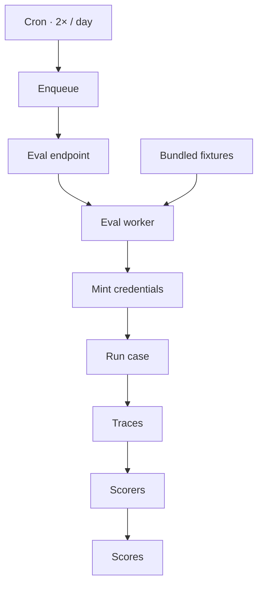

[Part 2](/blog/posts/building-an-ai-product-in-finance-2-agent-loop/) was the loop. This post is the thing that watches it.

The daily eval is how a change stops shipping without a measurement. An engineer can land a well-intentioned change and still degrade the assistant. The job records which day, and which commits, improved the harness or hurt it.

---

Story — without a measurement
-----------------------------

A loop without a morning number is an impression. A prompt is edited. A tool is added. Staging looks fine. A week later a support question about a tax lot reads like a generic brochure.

I wanted a repeatable process. Domain and case fixtures as YAML in the repo. Composable scorers — code or agent. A CLI for the change you are about to land. A dashboard for the aggregate and the one failing case.

I tried the usual answers:

- **Only a manual check in staging.** Fast. Not repeatable. The next person cannot rerun the chat.
- **Only production traces.** The failure shows up after the customer has already seen it. The chat still cannot be stored if it has PI / PII.
- **Only a vendor eval suite.** It works for a demo. A finance-shaped case, a frozen clock, and a firm account still require a fork.
- **Only `assert "tax lot" in answer`.** That checks the words. It misses the tool that should have been called, the sentence compliance will not allow, and the table that never showed up.

The cases stay in git, and the runner is a job.

---

Case fixtures
-------------

I cannot store PI / PII anywhere. I learned the *patterns* from production traffic. How those patterns become synthetic fixtures is the next post. This one is the gym those fixtures run in.

The taxonomy came first. About **30 domains**. About **400 cases**. Trading, portfolio, research, support, guardrails, and navigation. Engineers contribute cases. Engineers contribute scorers. The runner treats those files the same regardless of author.


A case is a small object on purpose:

```yaml
case:
  id: xxx
  history: <reference_to_history_fixture>
  query: ...
  timestamp: ...
  scorers:
    - name: compliance
      what_not_say: |
        ...
    - name: fact_grounding
      ground_on_help_center: true
      ground_on_corporate_actions: true
      ground_on_tools: true
    - name: response_structure
      requirements: |
        Must have a preamble, then a short description, then a table.
    - name: tools
      expect_tools: [a, b, c]
      unexpected_tools: [x, y, z]
```

The scorers compose. Compliance is "do not say this." Fact grounding is "stand on the help center, the corporate action, the tool result." Response structure is "preamble, then the table." Tools is an allow-list and a deny-list. They mix per case. A new judge is not required for every ticker.

The common name is LLM-as-judge. What I run is **agent-as-judge**. The grader is an agent. It has tools, including web search. A code scorer checks the tool trace. An agent scorer can look something up. It is not exact. It is still more practical than rereading about four hundred chats every morning.

That schema is also how I designed the rest of the pipeline: an **internal eval endpoint** with restricted permission, an **eval worker** that runs as the user the case is supposed to be, and a **cron** that starts the job.

---

In the repo
-----------

A case is a file. The taxonomy is the folder. An engineer lands a fixture the same way they land a skill: a PR.

```
eval/fixtures/cases/
├── support/
│   ├── red_team.yaml
│   ├── brokerage.yaml
│   ├── crypto.yaml
│   └── retirement.yaml
├── advisor/
│   ├── portfolio_rebalancing.yaml
│   ├── concentration.yaml
│   └── diversification.yaml
├── tax_lots.yaml
└── preamble.yaml
```

`support/` and `advisor/` are domains. `tax_lots.yaml` and `preamble.yaml` sit at the root because they cut across domains — a tax-lot question appears in support and in advisor. The cron reads the tree either way.

There is no ticket for an eval team. The change is a PR. The CLI runs the file that was just added. The next morning the dashboard includes the new case, or it shows that the case failed.

---

Firm accounts, and a frozen clock
---------------------------------

A YAML query is not enough for a brokerage account. The assistant is looking at *someone's* account.

So I keep **firm accounts**. They are real accounts in the system. Identity fields that would be PI, such as an SSN, are mocked. They hold a small amount of real money. That is how the suite simulates what a string fixture cannot: a funding deficiency, a long recurring-investment history, a long list of holdings and tax lots.

A string fixture also does not stay valid as the world moves.

A simulated scene does not stay still. The market moves, buying power moves, or the day in the YAML is no longer today. The case has to model three things:

1. Market data
2. User-scoped data
3. Time

So the case schema got a **frozen-time** latch. The timestamp on the case is not decoration. It pins the quotes, the lots, and the clock.


Without that latch, a case that passed on Tuesday fails on Wednesday because a quote moved. The failure is in the market data, not in the harness.

---

End to end
----------

The morning job is a pipeline.



Twice a day, every day. Cron enqueues. The internal endpoint is the only entry, and it checks permission. The worker reads the fixtures out of the bundled image, mints credentials for the firm accounts, runs each case, writes the trace, then runs the scorers.

The CLI is the same pipeline, pointed at a change that has not landed yet. Before a skill changes, the cases that skill owns get a run. There is no need to wait until the next morning to learn that a funding-deficiency case failed.

Then the dashboard. Two views of the same scores.

The first is the aggregate. Pass / fail over the last day. Case counts by domain — the taxonomy, live. A quiet morning is a flat pass line and a full set of domain tiles. The same view shows whether the worker is degraded: steps in the loop, and an isolated error spike.


The second is the one failing case. Four scorer panels — compliance, tools, response structure, activated skill. When a panel dips, the list under it is the fixtures that failed that scorer. I open the failing case instead of rereading about four hundred transcripts.


The point is the mechanism: a morning signal, at case level, tied to a commit.

---

Next
----

The gym is only as honest as the fixtures you are willing to put in git.

Next is [Part 4](/blog/posts/building-an-ai-product-in-finance-4-eval-sandbox/) — the eval sandbox. Personas and scenarios in git. A synthesizer that mocks the tools. Production sampling that proposes a PR. No PI / PII stored.
