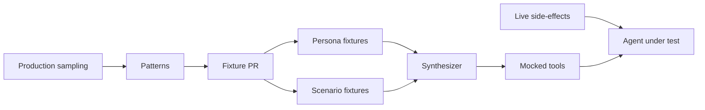

[Part 3](/blog/posts/building-an-ai-product-in-finance-3-daily-eval/) was the gym. This post is how I fill it without storing a customer.

The daily eval is accurate. It is also slow when the only way to run it is to land the change and wait for morning. I wanted the same cases on my laptop, and no PI / PII in git.

---

Story — waiting for morning
---------------------------

The assistant does not run from a prompt alone. It depends on upstream services: transfers, lots, activity, the help center, and in-app navigation. A YAML query without those dependencies is a generic answer.

The first local loop was: push, wait, read the morning job, push again. That is a batch report, not a development loop.

The requirement was to run the agent against a local change, resolve every dependency, and keep a real customer record off disk.

I tried the usual answers:

- **Wait for the morning job.** Accurate. The funding-deficiency failure shows up on a later run, not while the change is open.
- **Point local at staging.** The run then depends on staging data, staging's clock, and staging's availability. Staging still contains customer records.
- **Record and replay a real customer.** The fixture then contains PI / PII. It is a liability.
- **Hand-write a JSON mock for every tool.** Four hundred hand-written mocks do not stay current. The suite then covers only the mocks that were written.

The split that made the rest possible: the agent never sees those upstream services. The agent sees **MCPs** and **tools**. Mock those, and the upstream services stay out of the local run.

Bazel packs the runnable image. Local is the same binary as the job. The only thing that changes is who answers the tool call.

---

The synthesizer
---------------

I did not want a store of recorded payloads. The synthesizer is an agent whose job is to produce a tool result that fits a fixture.

The synthesizer takes a small, deliberate context:

- **Persona** — identity, feature flags, accounts, holdings
- **Scenario** — today's story, plus the facts that must be true
- **Tool input args** — what the assistant just asked for
- **Tool output shape** — the schema the harness already knows
- **Web search** — help-center and domain knowledge the synthesizer is allowed to look up
- **In-app navigation** — mocked, so a deep link still has somewhere to point

That is the whole window. Goal at the top. Persona and scenario in the sys-prompt. Tools the synthesizer itself may call. Then the user turn is just a tool name and a JSON args blob.

I put `@mockable` on every tool the platform has. The decorator detects offline and production. Offline, it intercepts the function and delegates to the synthesizer, which imagines the data. A side-effect that should stay live still runs. In production the function runs.

That is how the setup scales. I give just enough heuristics as a base: the context above. The synthesizer imagines a result for that tool and those inputs.

It is fast and cheap. The local run does not call an upstream service, and I do not seed test data.


The assistant under test still believes it called `transfers`. The response comes from another agent, given a synthetic persona and a scenario.

---

Offline, on the laptop
----------------------

Here is a local run.

`transfers`, `ach_transfer_history`, and `account_activity` do not hit a backend. Each one opens `eval_tool_synthesizer`, gets a response, and continues. The synthesizer imagines that response from a persona, a scenario, the function description, the function args, and an explanation. Engineers control the data behind the tools. The run holds no PI / PII. A local run returns that feedback immediately, so development speed and confidence improve together.


No customer record was loaded for that run. The persona is a file. The scenario is a file. The case is a file. Production traffic supplied the pattern. Git stores the synthetic fixture.

A separate process can sample production, learn those patterns, and open a PR that updates a persona or a scenario. The sampler never writes a row of PI / PII into the repo. A fixture enters git only through that PR.



---

Persona and scenario
--------------------

Two building blocks. I keep them apart on purpose.

A **persona** is who the customer is. Conservative parent. Student. Professional newbie. Professional veteran. YOLO. Savings, credit, risk appetite. The accounts they hold. The features that are on.

A **scenario** is what is going on *today*. Buying power held by options. Position closing only. A worthless security. A pending ACH. An unexpected post-trade debit. A failed withdrawal.

A persona can appear in many scenarios. A scenario can apply to many personas. Combined into one fixture, neither half can be reused.

```
eval/fixtures/
├── cases/
│   └── ...
├── personas/
│   ├── conservative_parent.yaml
│   ├── student.yaml
│   ├── professional_newbie.yaml
│   ├── professional_veteran.yaml
│   └── yolo.yaml
└── scenarios/
    ├── bank_debit_not_posted.yaml
    ├── buying_power_held_by_options.yaml
    ├── deposit_routing_mismatch.yaml
    └── credit_card_declined.yaml
```

`cases/` is the gym from [Part 3](/blog/posts/building-an-ai-product-in-finance-3-daily-eval/). `personas/` and `scenarios/` are what the synthesizer reads when a case needs a world. An engineer lands any of them the same way: a PR.

A persona is a profile, not a person. This one is invented.

```yaml
name: conservative_parent
timezone: America/New_York
identity:
  full_name: David Hale
  email: david.hale@example.com
  account_number: "123456789"
  state: CA
features:
  gold:
    status: active
  crypto:
    status: active
  options:
    status: level_2
  margin:
    status: disabled
accounts:
  - account_number: "i09x56789"
    account_type: brokerage_individual
    nick_name: My Life
    is_default: true
    cash: 10000.0
    holdings:
      - ticker: AAPL
        instrument_id: 450dfc6d-5510-4d40-abfb-f633b7d9be33
        quantity: 15.0
        average_buy_price: 165.0
        current_price: 205.0
```

A scenario is a story plus the facts the synthesizer is not allowed to contradict. The clock is a latch, same idea as frozen time in the gym.

```yaml
name: bank_debit_not_posted
clock: "2026-07-08T16:00:00-07:00"
story: >
  On July 3, 2026 the user's bank showed one ACH debit. The system has
  exactly one matching deposit attempt; it failed and reversed, so no
  funds posted. There are no other bank debits.
facts:
  transfers:
    - kind: ach_deposit
      status: failed
      initiated: "2026-07-03"
      account: default
      status_description: authorization reversed
      bank_account_nickname: Checking
```

David Hale does not exist. The ACH did not happen. The pattern — bank shows a debit, the app never posted it — is what I learned from production. That is the only thing I was allowed to keep.

---

How much to synthesize
----------------------

The boundary is easy to get wrong.

You can control the identity, the facts, the tool shape, and the clock. You can let the synthesizer produce the JSON wording, an extra plausible row, the help-center wording, and the navigation copy.


Too much control and the mock is hand-written. It becomes a JSON file that nobody updates.

Too much synthesis and Tuesday's case is not Wednesday's case. The scorer grades the synthesizer's variation instead of the assistant.

The facts in the scenario are the latch. The wording is the slack. If a fact is in the YAML, the tool result has to honor it. Everything else can vary.

---

Next
----

That is the four-post map I set out to write. Transport. Loop. Gym. Sandbox.

Next is [Part 5](/blog/posts/building-an-ai-product-in-finance-5-close-loop/) — close-loop automation. The eval onion. Offline when the change is in front of you, daily on sampled traces. A weekly agent that turns a miss into a fixture PR.
